<!--
  Управління процесами
  Варіант 6: `cat` — SIGTERM — 19 — Знайти процеси у стані D і пояснити їхню наявність

  Тему, мету й обладнання писати не треба — конвеєр візьме їх із лабораторної.
  Знімки екрана кладіть у assets/, вихідний код — у src/.
  Контрольні питання — лише одного рівня, того, на який захищаєте роботу:
  заголовок «### Достатній рівень», далі «1 Текст питання?» і відповідь.
  Покрокова інструкція — reports/README.md
-->

## Хід роботи

1 Номер індивідуального варіанта – 6.

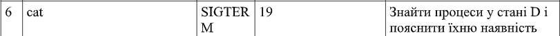

2 Було перевірено версію операційної системи Ubuntu, оновлено список пакетів та встановлено необхідні утиліти для роботи з процесами. Створено робочий каталог lab11 і два навчальні скрипти: cpu_load.sh для створення навантаження на процесор та parent_child.sh для дослідження батьківських і дочірніх процесів.

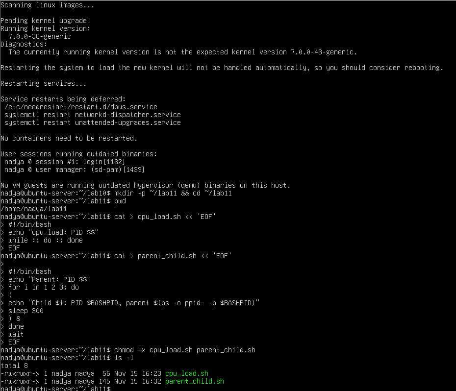

3 Команди відрізняються форматом виведення інформації. ps показує лише процеси поточного термінала, а ps aux і ps -ef дають змогу переглянути всі процеси системи, але відображають різні набори колонок.

| Команда | Що показує |
| --- | --- |
| ps | Процеси поточного термінала |
| ps aux | Усі процеси та використання ресурсів |
| ps -ef | Усі процеси з PID і PPID |

: Таблиця 1 — Призначення команд перегляду процесів

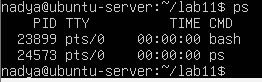

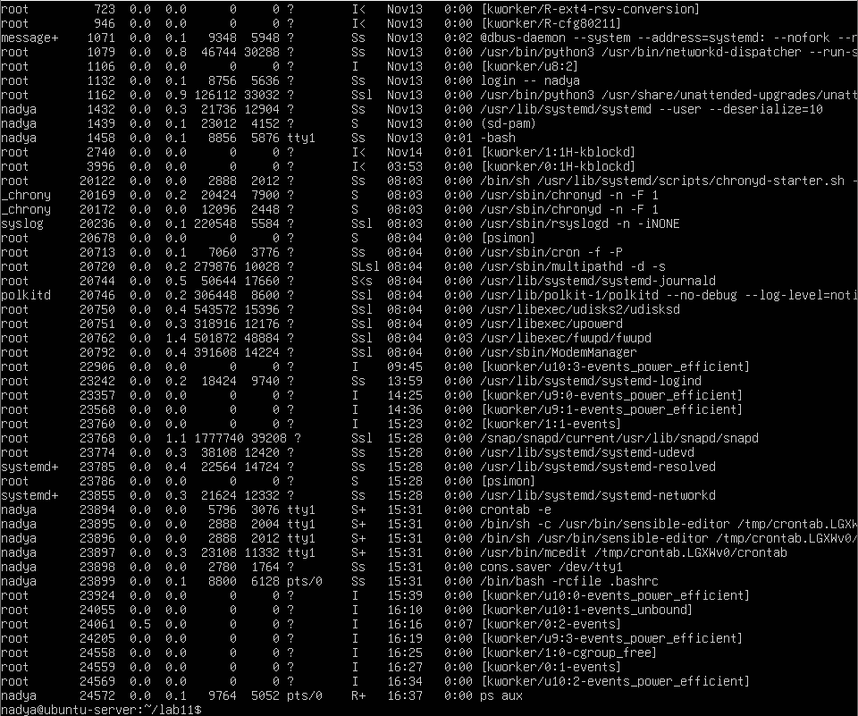

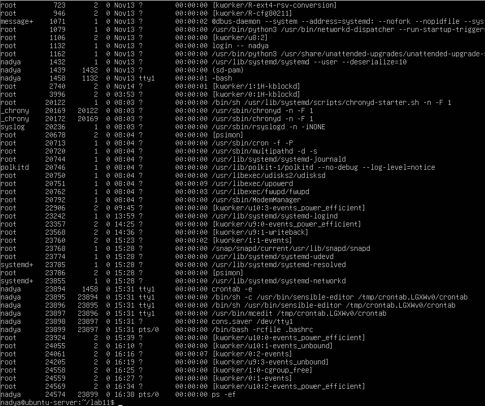

4 Для перегляду ієрархії процесів використано команду pstree -p. Після запуску скрипта parent_child.sh було створено один батьківський та три дочірні процеси. Їхні зв'язки можна побачити в дереві процесів. У підоболонці змінна $$ зберігає PID основного скрипта, а $BASHPID показує власний PID поточного процесу Bash. Тому для визначення PID дочірніх процесів використано саме $BASHPID.

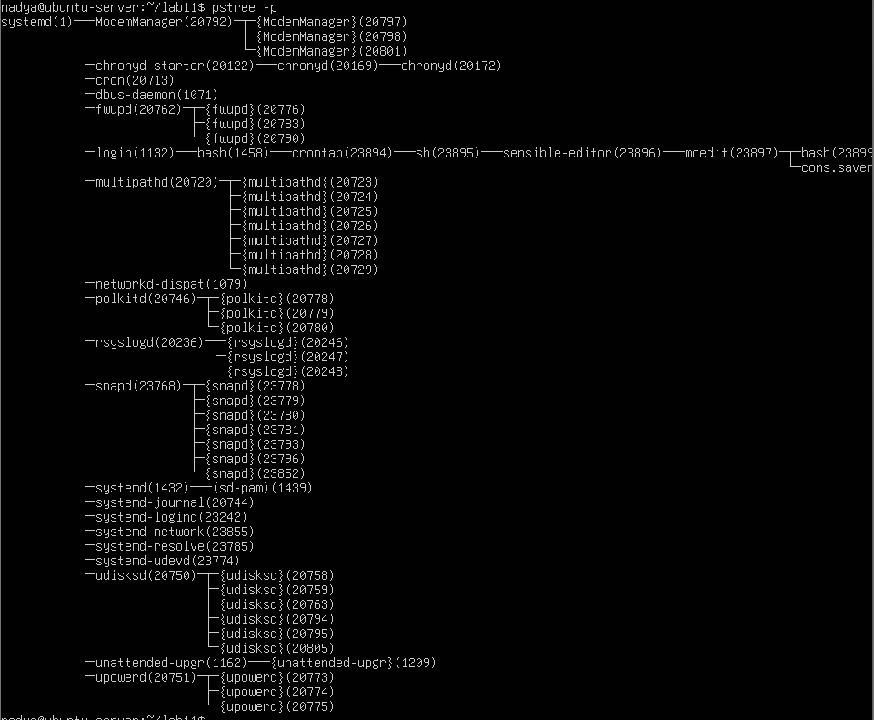

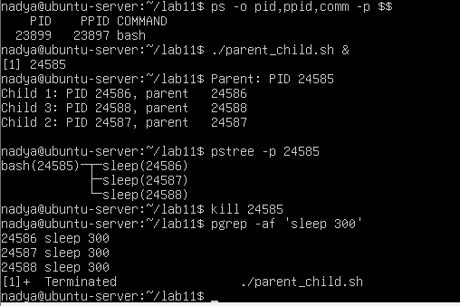

5 Для дослідження було запущено процес cat, який читав дані з /dev/zero та перенаправляв їх у /dev/null. За допомогою команди ps визначено PID, PPID, стан, пріоритет і використання пам'яті. Додаткову інформацію отримано з файлу /proc/PID/status. Для завершення процесу використано сигнал SIGTERM, після чого перевірено, що він більше не відображається у списку процесів.

| Параметр | Отримане значення |
| --- | --- |
| Назва | cat |
| PID | 24606 |
| PPID | 23899 |
| Стан | R |
| Nice | 0 |
| RSS | 7968 |

: Таблиця 2 — Характеристики процесу cat

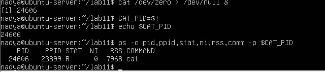

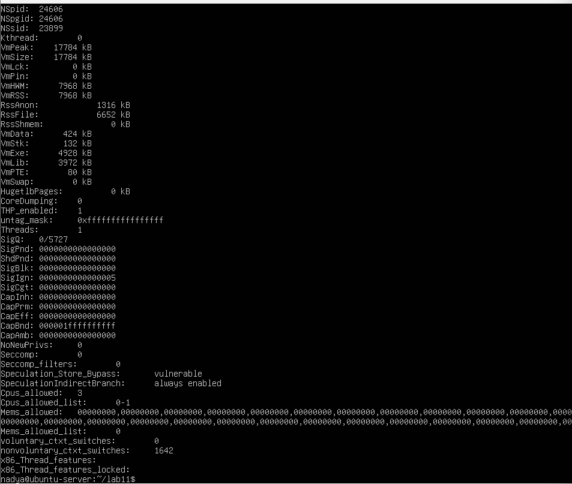

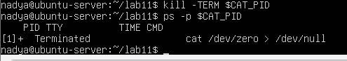

6 Для перевірки керування фоновими процесами було запущено скрипт cpu_load.sh. За допомогою Ctrl+Z процес призупинено, а командою bg відновлено його роботу у фоні. Команда fg повертає процес на передній план. Сигнал SIGSTOP зупиняє процес, а SIGCONT дозволяє продовжити його роботу. Наприкінці процес завершено сигналом SIGTERM.

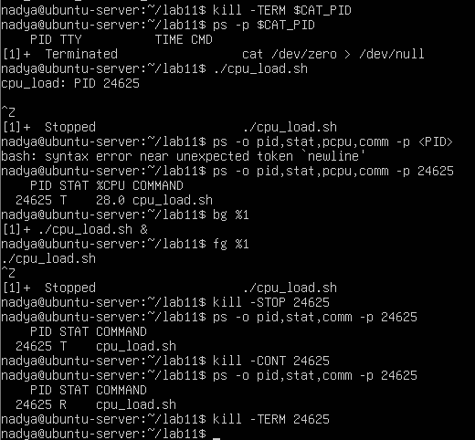

7 SIGTERM використовується для коректного завершення процесу. Програма може перехопити цей сигнал і виконати власні дії. У моєму випадку скрипт вивів повідомлення та продовжив роботу. SIGKILL примусово завершує процес, його неможливо перехопити або проігнорувати.

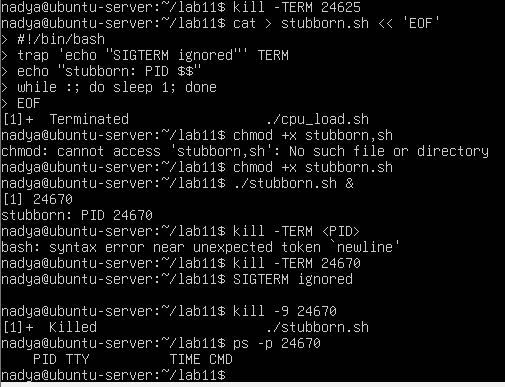

8 Для дослідження пріоритетів було запущено два процеси на одному ядрі процесора за допомогою taskset. Перший процес мав nice 0, другий — nice 19. За результатами спостереження порівняно частки використання CPU. Процес із більшим значенням nice має нижчий пріоритет планування. Під час перевірки команди renice встановлено, що звичайний користувач може збільшувати значення nice, але для його зменшення потрібні права адміністратора.

| PID | Nice | CPU (%) |
| --- | --- | --- |
| 24766 | 0 | 90.7 |
| 24767 | 19 | 1.3 |

: Таблиця 3 — Порівняння завантаження CPU для процесів із різними значеннями nice

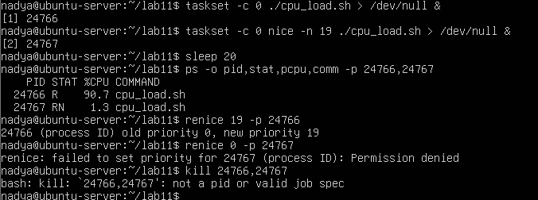

9 Під час виконання роботи було створено зомбі- та осиротілий процеси. Зомбі-процес ([sleep] <defunct>) уже завершив роботу, але його батьківський процес не забрав статус завершення через wait(), тому запис про нього залишається в таблиці процесів. Осиротілий процес (sleep 120, PID 24811) виник після завершення його батьківської оболонки, а його новим батьком став процес із PPID 1 (systemd / init).

| Тип процесу | Команда / стан | Особливість |
| --- | --- | --- |
| Зомбі-процес | `[sleep] <defunct>` (Z) | Завершився, але батьківський процес не забрав статус завершення |
| Осиротілий процес | `sleep 120` (PID 24811) | Батьківська оболонка завершилась, новий батько — `PPID 1` |

: Таблиця 4 — Досліджені зомбі- та осиротілий процеси

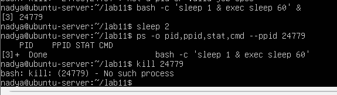

![Рисунок 15 - виявлення зомбі-процесів ([sleep] <defunct>) та осиротілого процесу (PID 24811, PPID 1)](assets/15.png)

10 У Windows за допомогою PowerShell було переглянуто список процесів і визначено три процеси з найбільшим використанням пам'яті (Memory Compression, chrome, Telegram). Запущено Блокнот (Notepad.exe, ProcessId = 10808, ParentProcessId = 15540). Пріоритет процесу змінено на BelowNormal, після чого програму завершено командою Stop-Process.

11 Індивідуальне завдання. Пошук процесів у стані D. Для пошуку процесів у стані D було використано команду ps з відображенням PID, PPID, стану (STAT), функції ядра очікування (WCHAN) та назви процесу (COMMAND), а для фільтрації використано awk. Перевірку повторено 10 разів з інтервалом в 1 секунду, але процесів зі станом D не виявлено.
Стан D (Uninterruptible Sleep) означає очікування завершення операції введення-виведення (наприклад, роботи з диском або пристроями), під час якого процес тимчасово не реагує на сигнали. Відсутність таких процесів під час перевірки є нормальною, оскільки їх поява залежить від поточного стану системи та наявності активних блокуючих операцій введення-виведення.

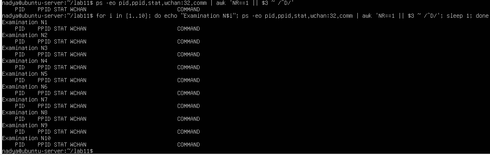

## Відповіді на контрольні питання

### Високий рівень (творчий)

1 Процес не реагує ні на SIGTERM, ні на SIGKILL. Назвіть можливі причини та порядок дій адміністратора.

Можливо, процес перебуває у стані D (непереривне очікування), наприклад, через проблему з диском або пристроєм. Також причиною може бути зависання драйвера чи обладнання. Адміністратор має перевірити стан процесу командою ps, переглянути системні повідомлення та журнали. Якщо процес перебуває у стані D, потрібно знайти й усунути причину очікування. Після цього процес можна завершити або перезавантажити систему, якщо проблема не зникає.

2 Сервер періодично «підвисає» під навантаженням. Опишіть, які показники процесів ви перевірите й у якій послідовності.

Спочатку я перевірю загальне навантаження на процесор і пам’ять за допомогою top або htop. Потім подивлюся, які процеси найбільше використовують CPU та RAM. Перевірю їхні стани, кількість процесів, пріоритети та наявність zombie-процесів. Якщо навантаження на процесор надто високе, перевірю, чи можна змінити пріоритет окремих процесів.

3 Поясніть, чому кількість zombie-процесів, що зростає, є ознакою помилки в програмі, а не в ядрі.

Zombie-процеси з'являються, коли дочірній процес уже завершив роботу, але батьківський процес не отримав його код завершення. Через це запис про процес залишається в таблиці процесів. Якщо кількість таких процесів постійно зростає, це означає, що програма неправильно обробляє завершення дочірніх процесів. Ядро лише зберігає інформацію, яку має забрати батьківський процес.

4 Сформулюйте критерій, за яким адміністратор обирає між зміною пріоритету процесу та його завершенням. Проілюструйте прикладом.

Якщо процес потрібний для роботи системи, але використовує забагато ресурсів, краще знизити його пріоритет за допомогою nice або renice. Якщо процес завис, працює неправильно або створює серйозні проблеми, його можна завершити. Наприклад, якщо фонове завдання займає багато процесорного часу, але має завершитися, я знижую його пріоритет. А якщо програма перестала відповідати й заважає роботі сервера, після перевірки її можна завершити.

## Висновок
Під час роботи я з’ясувала, що для діагностики процесів адміністратор використовує команди ps, top, htop, pstree та перегляд файлів у /proc. За їх допомогою можна перевірити стан процесів, їхні пріоритети, використання пам’яті та процесорного часу. Для усунення проблем застосовують сигнали, зміну пріоритету за допомогою nice і renice, а також завершення процесів. Це допомагає знаходити причини зависань і підтримувати стабільну роботу системи.
